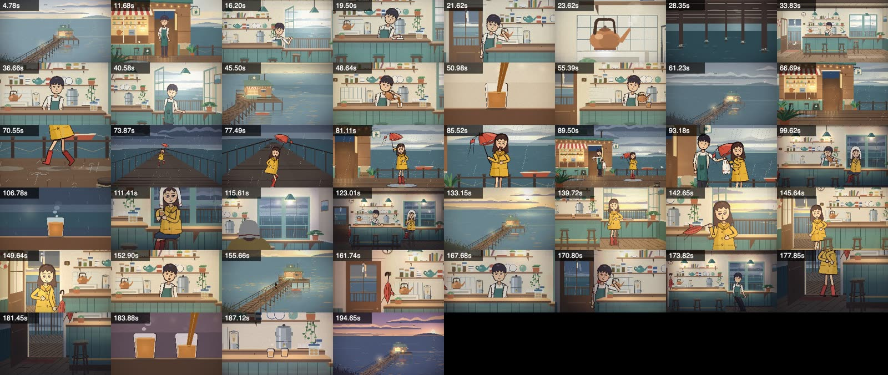
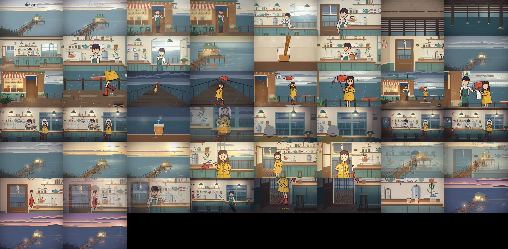

# ต้นกับทะเล · Ton and the Sea

A 3 min 20 s hand-painted animated short made entirely in code: every frame of the picture, every sound effect and every
note of the music. It was built with [Claude Code](https://claude.com/claude-code) on
[ClaudeAnimationBase](https://github.com/JohnHeibel/ClaudeAnimationBase) (p5.brush, rendered in headless Chrome).

A quiet man runs a tiny tea shop at the end of an old pier. One rainy afternoon a girl in a yellow raincoat runs in out of
the storm, her umbrella broken. He makes her tea. The rain stops, she leaves the umbrella with him, and on every rainy day
after that he puts the kettle on and waits.





**How it was made, step by step:** [docs/METHOD.md](docs/METHOD.md). **Use the same method in your own project:** open
this repo in Claude Code and the `code-video` skill ([.claude/skills/code-video](.claude/skills/code-video/SKILL.md))
loads; ask it for a short film about anything.

## What is in here

| Part | How |
|---|---|
| Picture | p5.brush gouache washes and ink lines, flat 2D, boiling line work. Every frame is a pure function of time `t`, so frames render in parallel and resume after a stop. 25 storyboard shots, 44 cuts, 199.95 s at 24 fps. |
| Characters | An original rig in code: two-bone IK arms and legs, lean, nod, shrug, breathing, blinks, props (kettle, tea glass, towel, umbrella), a run/walk cycle with splashes. |
| Dialogue | 22 English lines, Gemini 3.8 Flash TTS on Vertex AI with two prebuilt voices (Ton: Umbriel, Mai: Sulafat). The mouths open with the loudness of the audio. |
| Sound effects | Synthesized in Node from noise and sine waves, no samples: sea and waves on the posts, rain (outside and through the walls), wind, thunder, gulls, shutters, the kettle and its flame and whistle, tea pours whose pitch rises as the glass fills, the door chime, boots in puddles, steps, drips, a clock. |
| Music | An original waltz in F written as code (`scripts/score.mjs`), rendered offline through the General MIDI sound bank built into macOS. The melody keeps to the gaps between the spoken lines. |
| Titles and subtitles | `src/titles.js`, drawn over the finished frame: the title and credits paint themselves into the dawn sky of the first shot; each spoken line is hand-lettered beside (or over) the head of whoever speaks, Ton in cream, Mai in the yellow of her raincoat, the words arriving with the voice and leaving the way the scene's weather moves (washed down by rain, lifted like tea steam, carried off by the breeze). |
| Mix | Each stem set to a loudness target, the music ducks under the voices, two-pass loudness normalisation, and an automatic check that every spoken line stands at least 8 dB above everything under it. |

## Quick start

You need Node 20+, Google Chrome and ffmpeg. The music step needs macOS (Swift and AVFoundation). New dialogue lines need
Python 3 and the Google Cloud CLI with the Vertex AI API enabled; the 22 takes used in the film are already in
`out/voice/raw/`.

```bash
git clone https://github.com/Kreycin/ton-sea.git
cd ton-sea
npm install
```

Open `studio.html` in Chrome to scrub and play the film (open it from the cloned folder: it loads `node_modules/`).

### 1. Build the soundtrack

```bash
node scripts/dialog.mjs                      # place the 22 lines -> out/audio/dialogue.wav, src/dialog.js (lip-sync)
node scripts/shotlist.mjs > out/shots.txt    # shot start times (already in the repo; re-run after you move shots)
node scripts/sfx.mjs                         # -> out/audio/sfx_sea.wav, sfx_rain.wav, sfx_wind.wav, sfx_fx.wav
node scripts/score.mjs                       # -> out/music/score.json
swift scripts/render_music.swift out/music/score.json out/music/music.wav
node scripts/mix.mjs                         # -> out/audio/mix.wav, then prints the dialogue audibility check
```

If `swift` stops with "this SDK is not supported by the compiler", point it at an SDK that matches your Command Line Tools,
for example `SDKROOT=/Library/Developer/CommandLineTools/SDKs/MacOSX26.5.sdk swift scripts/render_music.swift ...`.

### 2. Render the film

```bash
node render.mjs --frames --workers=2         # ~4800 JPEG frames -> out/frames (resumable; ~40 min on an 8 GB M-series Mac)
node render.mjs --encode --audio=out/audio/mix.wav --out=out/video.mp4   # frames -> MP4 with the soundtrack
```

Delete `out/frames` before a full render if you changed anything: stale frames are reused.

### 3. Look at it

```bash
node render.mjs --sheet=12.2,86.1,99.3,143.5 --cols=2 --w=640 --out=out/check/a.jpg   # frames at chosen times
node render.mjs --strip=69.2:70.2 --cols=6 --w=320 --out=out/check/run.jpg           # every frame of a moment
node render.mjs --sheet=143.51 --crop=740,300,440,300 --w=440 --out=out/check/face.jpg  # a full-resolution crop
node render.mjs --clip --range=84:100 --out=out/check/talk.mp4                       # a short clip with sound (PROJECT.audio)
```

## Project map

| Path | What it is |
|---|---|
| `studio.html` | The page that loads everything, in order. |
| `src/core.js`, `src/timeline.js`, `render.mjs` | The engine from ClaudeAnimationBase: brush drawing, camera, shots, dissolves, the headless renderer. |
| `src/config.js`, `src/air.js` | Length and audio; the air-time plan that stretched the first 117.75 s cut to 199.95 s. |
| `src/cast.js`, `src/moves.js` | The two characters' rig, and one function of shot time per acted beat. |
| `src/scenes/ghibli.js`, `interior.js`, `seascape.js`, `stage.js` | The sets: the shop front in the rain, the interior with six light states, the wide seascape, shared staging. |
| `src/scenes/a01_shop.js` … `a05_coda.js` | The five acts. Each one is a list of `[startTime, shotFunction]`. |
| `src/dialog.js` | Generated: when each line plays and its mouth envelope. |
| `src/titles.js` | The opening title and credits, and the subtitles (text, placement, weather exits). |
| `scripts/` | Sound and tools: `tts_dialog.py`, `dialog.mjs`, `shotlist.mjs`, `sfx.mjs`, `score.mjs`, `render_music.swift`, `mix.mjs`. |
| `STORYBOARD.md`, `DIALOGUE.md` | The shot table (written in Thai, for the first narrated cut) and the English dialogue. |
| `ANIMATION_GUIDE.md` | The kit's guide to the engine and its rules. |
| `STATUS.md` | The working log the agent kept between sessions. |
| `.claude/skills/code-video/` | The method as a Claude Code skill. |

Kept for reference only: `src/scenes/styles.js` (rejected style tests), `src/scenes/animatic.js` and
`scripts/animatic.py` (the held-still animatic), `scripts/air.mjs`. The last two need the Thai narration of the first cut,
which is not in this repo.

## Credits and licences

- Engine: [ClaudeAnimationBase](https://github.com/JohnHeibel/ClaudeAnimationBase) by John Heibel, MIT. Its notice is kept
  in `LICENSE`.
- Libraries from npm (not included in the repo): p5.js (LGPL-2.1), p5.brush (MIT), Puppeteer (Apache-2.0).
- Voices: Google Gemini 3.8 Flash TTS prebuilt voices on Vertex AI. The generated takes are in `out/voice/raw/`.
- Music: the notes are original (`scripts/score.mjs`). The sound comes from the General MIDI bank that ships with macOS,
  so the repo has the score and the renderer, not the recording: render it on your Mac.
- Sound effects: synthesized from scratch in `scripts/sfx.mjs`.

Code and film: MIT, see [LICENSE](LICENSE).
