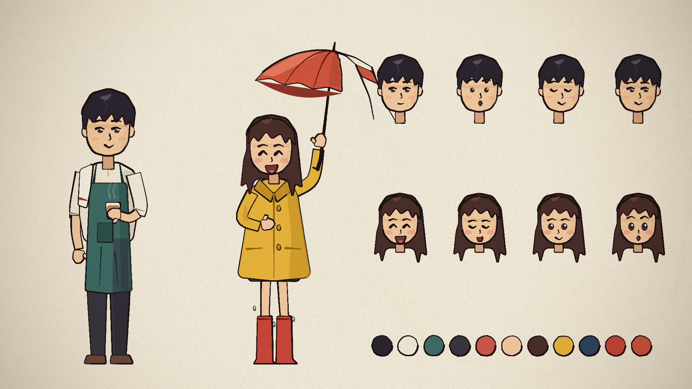
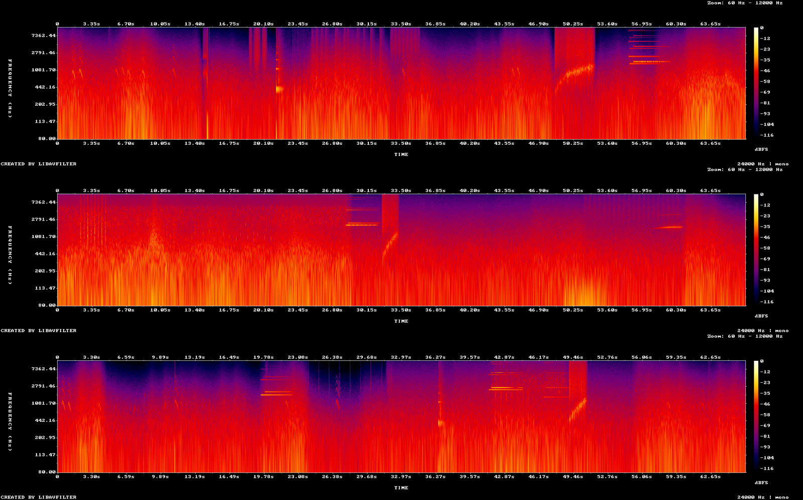

# How "Ton and the Sea" was made

The film was made in one long conversation between a person (the director) and Claude Code (the animator, sound designer
and composer). The director never drew or wrote code. Claude wrote every file, rendered check images after each step,
looked at them itself, and sent short clips for the director to judge. This file is the method, in the order it happened,
so you can repeat it on your own story.

The same method is packaged as a Claude Code skill in [.claude/skills/code-video](../.claude/skills/code-video/SKILL.md).

## The rules that held everything together

1. **Every frame is a pure function of time.** `drawWorld(t)` draws the frame at second `t` from nothing: no state carried
   between frames. Random-looking things (rain, boiling lines, waves) use a seeded hash of `t` and an id. That is why the
   film renders on several workers at once, why a stopped render resumes, and why any single frame can be checked.
2. **Look at every change.** After each step Claude rendered a contact sheet, a strip of consecutive frames or a
   full-resolution crop, and read the image before saying the step was done. Most bugs were found this way, not by
   the director.
3. **One acted beat per line.** Each line of the story (first the narration, later the dialogue) gets something the
   character visibly does, and something in the world that answers it.
4. **Keep a working log.** `STATUS.md` (under 80 lines) holds the goal, what is done, the decisions and the next step.
   Every session started by reading it, so the work survived the conversation running out of context many times.

## 1. Story and storyboard

The director gave a one-line idea: a quiet tea shop at the end of a pier, a girl who comes in from the rain. Claude wrote
`STORYBOARD.md`: a logline, the two characters, a chain of props that carry the story (the broken yellow umbrella, the
kettle, the tea glass), a colour arc (silver morning, grey, rain, gold after the rain, calm dusk) and a table of 25 shots
with time, framing and action. The director approved the table before any scene was drawn.

## 2. Style tests

`src/scenes/styles.js` keeps the rejected tests. The chosen look, in `src/scenes/ghibli.js`: gouache washes with no
outlines on the backgrounds; the characters with one thin dark line and one cel shade; a cold world where the only warm
light comes from the shop; no lettering on screen. These rules went into `STATUS.md` so every later scene followed them.

## 3. The cast and the rig

`src/cast.js` draws Ton and Mai from a pose object: body position, lean, turn, head nod and tilt, brows, eyes, mouth,
two-bone IK arms that reach for a world point, legs, breathing and blinks, and the props they hold. A model sheet of every
control (`src/scenes/castsheet.js`, see `docs/img/cast.jpg`) was approved before acting started.



`src/moves.js` holds one function per acted beat (pour, offer the glass, wipe the counter, run through the rain, sit,
stand) that returns the pose at a given shot-local time. Scenes call these instead of animating by hand.

## 4. Sets and staging

Three painted sets, each a function of time and a light state: the shop front in the rain (`ghibli.js`), the interior
with six lights from morning to dusk (`interior.js`) and the wide seascape (`seascape.js`). `stage.js` puts the cast in
the sets so that a cut from wide to close keeps everyone in the same place.

Depth, back to front: sky strata, sea and a haze veil, the shop and railing, the deck, the cast, the rain, a foreground
frame. Keeping that order fixed kept every shot readable.

## 5. Animatic, then acting, one act at a time

A held-still animatic (`scripts/animatic.py`) checked the timing of the 25 shots against the first narration. Then each
of the five acts became a file `src/scenes/aNN_name.js`, a list of `[startTime, shotFunction]`. After each act Claude ran
the review loop:

```bash
node render.mjs --sheet=t1,t2,...,t12 --cols=4 --w=480 --out=out/check/a03.jpg      # one frame per beat
node render.mjs --sheet=t1 --crop=x,y,w,h --w=600 --out=out/check/a03_face.jpg     # faces and hands at full size
node render.mjs --strip=a:b --cols=6 --w=320 --out=out/check/a03_move.jpg          # every frame of one gesture
node render.mjs --clip --range=a:b --out=out/check/a03.mp4                         # timing with sound
```

Questions asked of every sheet: does each beat read as a distinct action? Is the face readable? Do the hands touch what
they hold? Is anything cropped by the camera? Does a glow wash out a face?

## 6. Smooth pass

The first full cut moved in snaps. The fixes: 0.55 s dissolves between shots in the same place, eased camera moves, a
small idle sway so nobody freezes, and eased returns to rest poses. A frame-difference check found any jump that was not
a cut: compare each frame to the one before and list the frames whose difference is far above the median, then check
that every one of them is on a shot start.

## 7. Air time

The director's note on the 117.75 s cut: everything happens too fast. `src/air.js` opens 44 gaps in the timeline (82.2 s
in total) without touching the shot code: every shot time goes through a warp function (`AIRV`, `AIRG`) that maps the old
time to the new one, and three short inserts fill some gaps (a kettle close-up, two tea-pour close-ups, boots splashing in
the rain). The film became 199.95 s.

## 8. Sound: no narrator

The first cuts had a narrator. The director then asked for no narration at all: the sounds of the events, the two
characters talking in English, and music. The soundtrack is built by six scripts, in this order:

| Step | Script | What it does |
|---|---|---|
| Voices | `python3 scripts/tts_dialog.py out/voice/lines.json out/voice/raw` | 22 lines through Gemini 3.8 Flash TTS on Vertex AI. The director picked the voices from auditions of the prebuilt ones: Umbriel for Ton, Sulafat for Mai. |
| Dialogue | `scripts/dialog.mjs` | Places each take at its start time (the `AT` table), levels the lines, writes `out/audio/dialogue.wav`, and writes `src/dialog.js`: the loudness of each line every 1/24 s, which opens the mouths (`SPEAK(who, t)` in `cast.js`). |
| Shot list | `scripts/shotlist.mjs` | Loads the page headless and prints every shot's start and length to `out/shots.txt`, so sounds can be placed on shots, not on raw seconds. |
| Effects | `scripts/sfx.mjs` | Synthesizes everything from seeded noise, filters and sine partials: the sea with waves on the posts, rain outside and through the walls, wind, thunder, gulls, the kettle's flame and song, pours, the door chime, steps and boots, drips, a clock. A per-shot ambience table crossfades at the cuts. Four stems. |
| Music | `scripts/score.mjs`, `scripts/render_music.swift` | A waltz in F, 3/4 at 72 BPM, written as note events (piano, strings, cello, pizzicato, harp, celesta, flute). The melody plays in the gaps between lines; under speech it keeps to held chords. Swift renders the events offline through `AVAudioUnitSampler` and the General MIDI bank that ships with macOS. |
| Mix | `scripts/mix.mjs` | Gives each stem a loudness target, ducks the music and the ambience under the voices, fades in and out, and normalises to -15 LUFS, -1.5 dBTP in two passes. Then it checks every line: speech-band loudness of the voice against everything else under it, aiming for at least 8 dB. |



Claude cannot listen. It checked timing on spectrograms (did the thunder land on the flash? does the pour rise as the
glass fills?) and intelligibility with numbers; the director listened and gave notes on levels and sounds.

## 9. Titles, subtitles and a second look at the arms

The director asked for subtitles that belong to the story rather than a plain strip at the bottom, and for an opening
title with credits. `src/titles.js` draws both on the finished frame, after the dissolve and before the paper grain (so
the grain lies over the letters too). `cast.js` leaves each speaker's head position on screen in `HEADS`; a line stands
beside that head on its outer side, or over it when the other character is in the way, and drops low and italic when the
speaker is off screen. Words appear at onsets estimated from the loudness envelope, and each line leaves with its scene's
weather: washed down in the rain, lifted like steam indoors, blown sideways by the breeze after the rain.

The same pass fixed Ton's arms, which the director found hard to watch. The cause was in the drawing, not the poses:
the sleeve was a square-ended slab that sat on the body like a plank, the forearm was a thin stick, and the towel over
one shoulder hung outside the body's outline, where it read as a third arm. The sleeve now has a round shoulder cap and
covers the top of a fuller forearm, and the towel drapes down the chest. Three poses changed too: hands back on the sill
after the shutters open, elbows down in the shrug, and the hands wide on the noren so no arm passes behind the head.

## Gotchas we hit

- A biquad filter whose centre frequency goes below zero blows up: the wind stem once peaked at +168 dB. Clamp it.
- The 12 fps lip-sync sampled between syllables and the mouths stayed shut: take the louder of the two frames in each
  bucket.
- ffmpeg's `ebur128` prints a running `I:` value every frame. The integrated loudness is the last one, not the first.
- In ffmpeg, an unconnected filter output is an error. End branches you do not need with `anullsink`.
- A thunder roll under a line made it unreadable: shorten the roll and fade the whole sum, then re-run the check.
- The Swift that ships with the Command Line Tools may not match the default SDK. Point `SDKROOT` at a matching SDK.
- `hash()` in the engine takes numbers only; use `boilSeed('name')` for strings.
- The last shot gets its length up to the end of the film. In an act's last shot, compute the length locally.
- Raw p5 drawing inside a brush frame needs `flushBrush()` first, or the layers come out in the wrong order.
- A limb drawn as a ribbon has square ends. Round the end that meets the body, or the arm looks bolted on.
- Anything hanging just outside a character's outline (a towel, a strap) reads as a limb. Keep it inside the silhouette.
- Inside `cast.js`, `W` is a local helper, not the frame width: use p5's `width` there.
- With 8 GB of memory, render with `--workers=2`. Frames are resumable, so delete `out/frames` after changing anything.

## Make your own

1. `git clone https://github.com/JohnHeibel/ClaudeAnimationBase.git my-film && cd my-film && npm install`.
2. Copy `.claude/skills/code-video` from this repo into the new project (or into `~/.claude/skills/`).
3. Open the project in Claude Code and describe the film you want, in one or two sentences. Ask for the storyboard first,
   approve it, then the cast, then one act at a time.
4. Keep `STATUS.md` short and ask Claude to update it after each step.
5. For sound, reuse the scripts here: change the `AT` table, the ambience table and the events in `sfx.mjs`, and write
   your own cues in `score.mjs`.
